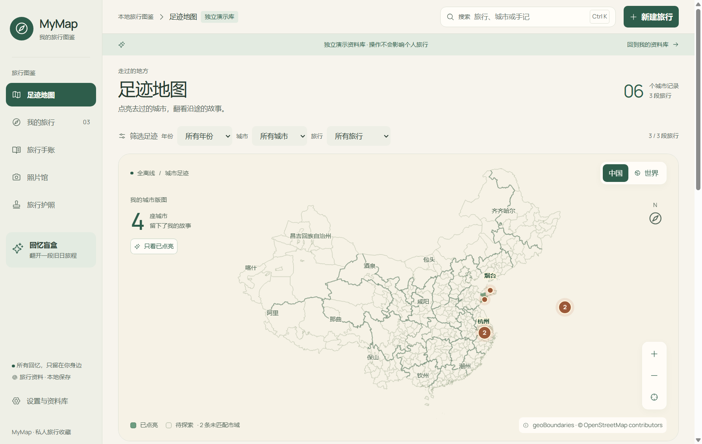

# MyMap · 旅行手账

[](https://github.com/Lisalsj/MyMap/actions/workflows/windows.yml)

**用自己的地图，收藏走过的路。**

支持离线使用的 Windows 旅行记录软件。把城市、景点、游记和本地照片，放进一本米白与森林绿的旅行图鉴。



## 下载与开始

从 [最新发行版](https://github.com/Lisalsj/MyMap/releases/latest) 下载 Windows x64 程序：

- 文件名含 `Setup`：安装版，可选择安装位置。
- 文件名含 `Portable`：免安装，直接运行。
- `SHA256SUMS.txt`：对应程序的 SHA-256 校验值。

首次打开后，点击“新建旅行”，添加城市或景点，再写手记、导入照片。设置中的独立演示库可用于体验功能，演示内容不计入个人足迹。

程序未签名，Windows 可能显示未知发布者。请核对下载来源与校验值，无需关闭系统安全功能。

## 主要功能

- **点亮城市**：中国市域边界、整城染绿、城市回忆面板；支持世界足迹、城市检索、年份筛选、聚合与足迹回放。同城重复到访只点亮一次，未定位记录也能保存。
- **旅行手账**：按旅行和到访组织记录，支持无日期旧旅行、标签、地点排序，以及 Markdown 预览、自动保存和图文导出。
- **本地照片馆**：批量或拖拽导入 JPEG / PNG / WebP，保留原图并按内容去重；支持封面、说明、排序、大图和照片 GPS 确认。
- **回忆与管理**：城市护照印章、回忆盲盒、回收站、完整备份恢复和资料库切换。

旅行目录支持按日期、最近修改或名称排序，并可切换卡片与目录布局。照片馆提供舒展、紧凑两种密度。手账的“专注”按钮收起目录，按 Esc 返回；Ctrl+K 搜索，方向键选择结果，Enter 打开，Ctrl+N 新建旅行。

[旅行详情](docs/screenshots/trip-detail.png) · [照片馆](docs/screenshots/gallery.png)

地图用于记录足迹，不提供道路导航或完整商家检索。中国市域主要采用 2017 年概略快照，台湾目前仅省域轮廓；海外及未覆盖地点仍保留足迹。下辖城镇可能点亮所属市域，护照城市数与点亮市域数因此可能不同。来源和覆盖见 [数据说明](resources/DATA-LICENSES.md)。

## 资料与备份

默认资料库：`%LOCALAPPDATA%\MyMap\Library`，可在设置中查看和切换。

- 照片导入会复制原图，不修改源文件。文字、关联和受管理照片仅保存在本地，不上传 GitHub。
- 删除先进入回收站；清空时仍被其他记录引用的原图会保留。
- 换电脑请使用完整备份恢复，或关闭所有 MyMap 后整体复制资料库。免安装程序本身不携带资料。
- 恢复会校验数据库和原图，创建新资料库并保留原库。建议定期把完整备份放到另一块磁盘。
- 不提供云同步、资料加密或 HEIC / RAW / 视频支持。

安装版可选择开启每日更新检查，也可在设置中手动检查。下载和重启安装都需要确认；只有更新服务会联网，旅行资料不会上传。旧版需先手动安装一次带更新功能的新版；免安装版下载后手动替换程序。

## 本地开发

需要 Windows 10/11 x64、Node.js 24 和 npm。

```powershell
npm ci
npm run dev
```

```powershell
npm test             # 单元和数据测试
npm run format:check # 格式检查
npm run build        # 类型检查与生产构建
npm run test:e2e     # 真实 Electron 界面流程
npm run dist:win     # 安装版和免安装版，输出至 release/
npm run checksums
```

首次安装依赖需要下载 Electron 运行时；成品不需要 Node.js 或网络。字体、图标、地图及城市索引已随程序附带，常规构建无需重建地图。

- [架构与目录](docs/ARCHITECTURE.md)
- [验证方法与已知限制](docs/VALIDATION.md)
- [构建与发布](docs/RELEASE.md)

## 许可证

代码及原创演示插画使用 [MIT](LICENSE)。地图、城市数据、字体和组件保留各自许可，见 [第三方说明](resources/THIRD-PARTY-NOTICES.md)。
