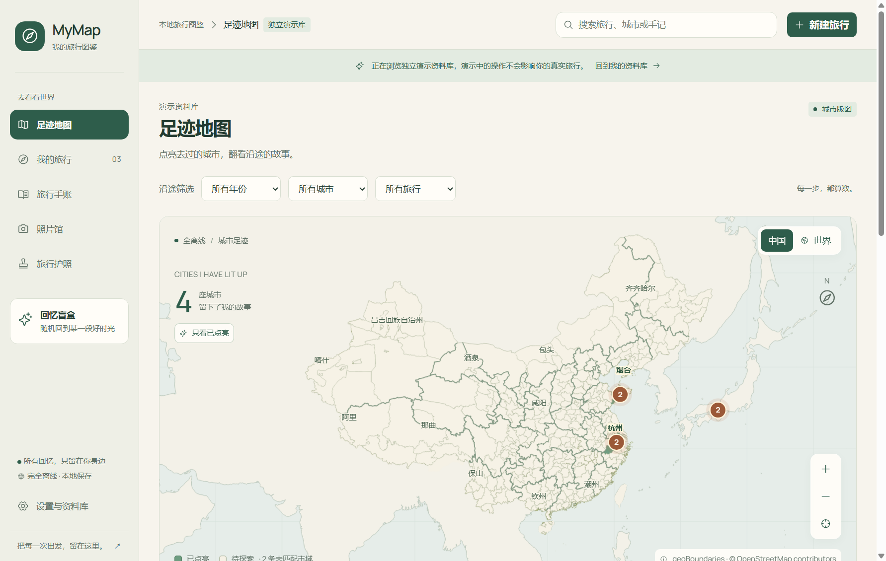

# MyMap · 旅行手账

[](https://github.com/Lisalsj/MyMap/actions/workflows/windows.yml)

**用自己的地图，收藏走过的路。**

一款完全离线的 Windows 旅行记录软件。把去过的城市、玩过的景点、自己写的游记和本地照片，放进同一本温暖的旅行手账。



## 下载与开始

从 [GitHub Releases](https://github.com/Lisalsj/MyMap/releases) 下载 Windows x64 版本：

- `MyMap-0.3.2-Setup-x64.exe`：安装版，可选择安装位置。
- `MyMap-0.3.2-Portable-x64.exe`：免安装，直接运行。
- `SHA256SUMS.txt`：程序文件的 SHA-256 校验值。

首次打开是空的个人资料库。点击“新建旅行”，填写标题，再添加城市或景点、写手记、导入照片。也可以在设置中打开独立演示库，先看看整体效果；回到个人资料库后，演示记录不会出现在你的统计中。

程序未使用商业代码签名证书，Windows 可能显示未知发布者。请核对下载来源与文件校验值，不需要关闭系统安全功能。

## 可以做什么

- **城市点亮地图**：真实市域分区、整城染绿、城市回忆面板、聚焦与标签避让；中国与世界视图、中文/英文/部分拼音城市检索、标记聚合、选点和足迹回放。无坐标但确定城市的记录也能点亮，同城多次到访只点亮一次。
- **旅行与到访**：每次旅行可包含多个地点；同一个城市或景点可以反复到访，日期可以留空，地点顺序可以调整。
- **Markdown 手账**：编辑与预览、本地照片插入、自动保存、退出前保存、导出 Markdown 和配套原图。
- **照片馆**：JPEG / PNG / WebP、批量导入、拖拽、缩略图、照片说明、封面、排序、旅行/地点/手记关联，以及照片 GPS 的手动确认。
- **一点小惊喜**：城市护照印章、从自己的旅行中随机翻出回忆的“回忆盲盒”。
- **资料管理**：回收站、完整备份、校验恢复、切换本地资料库。

地图是概略足迹图，没有道路导航或完整商家数据库。检索不到的地方可以手动添加。照片中的 GPS 按 WGS84 使用，来自其他坐标系统的坐标应先自行转换。

## v0.3.2 点击反馈与地图交互

- **地图点击更清楚**：修复放大后点击城市出现巨大橙白焦点框的问题，保留森林绿选中态；键盘聚焦市域时沿真实边界提示，描边宽度不随地图放大。
- **焦点反馈更统一**：全局搜索与照片搜索保留单层焦点提示；从地图打开对话框后，关闭时可以回到原来的 SVG 触发点。
- **按压状态更稳定**：整理通用按钮与组件按压样式的优先级，减少动态效果设置也适用于按压反馈。
- **点位计算更精简**：合并点位投影、视口筛选与聚合，减少重复遍历，保留聚合成员与原记录的关联。

延续 v0.3.0 的旅行图鉴界面与资料库格式，全部功能继续离线运行。本次点位计算调整不代表已解决大型 SVG 地图连续缩放时的长帧问题。修复范围、根因与验收安排见 [点击反馈与地图交互优化计划](docs/plans/2026-10-26-click-feedback.md)。

## v0.3.0 旅行图鉴

地图、旅行、手记、照片、护照、设置和编辑表单统一更新为米白与森林绿的旅行图鉴。放大地图画布，整理信息层级，使用更清楚的字号、统一的按钮和 Phosphor 图标；窄窗口通过侧栏收起与内容重排适配，辅助文字最低 12px。

- **记录更顺手**：旅行详情把地图、地点顺序、手记和照片分区；可选坐标单独展开，未定位的地点依旧能保存。
- **手记归属更明确**：分别显示“查看范围”和“新手记保存到”，保留自动保存、预览、本地图片与导出。
- **照片草稿有保护**：切换照片、关闭详情、切换页面和退出前先保存说明与关联；保存失败保留草稿并阻止离开，GPS 确认只合并定位关联。
- **键盘操作更完整**：`Ctrl+K` 聚焦全局搜索，对话框限制焦点范围，嵌套窗口只由最上层处理 `Esc`，支持减少动态效果。
- **结构更清楚**：页面和样式按功能拆分，复用快照索引，关闭的搜索不扫描正文；应用统一监听导入完成，照片馆未打开时也能更新资料。

字体使用 Manrope 与 Windows 中文字体，并随程序附带 Noto Sans SC 中文后备；字体、图标和地图均不依赖在线加载。资料库结构保持兼容，已有旅行、照片和手记可以继续使用。设计依据和实施范围见 [全页面改造计划](docs/plans/2026-10-26-whole-app-redesign.md)，逐页演示截图位于 [截图目录](docs/screenshots/v0.3.0)。

v0.3.0 继续使用自带运行时的 Electron 和经过精简的资源清单。历史本机安装包 **110.24 MiB**、免安装包 **110.02 MiB**，较 v0.2.0 略小；主要体积仍来自 Chromium 与 Node.js。详见 [v0.3.0 体积报告](docs/reports/size-v0.3.0.json)，云端程序请使用对应 Release 附件的校验文件。

## v0.2.0 城市版图

中国地图加入真实地级市、自治州等区域，四个直辖市及港澳按整域展示。省界、市界和城市标签形成层次；点击市域查看关联旅行，放大后文字与标记保持清晰。世界视图继续展示已有地点足迹。

边界采用 **2017 年概略快照**，补充省级轮廓和直辖市、港澳；莱芜等之后的区划变动未合并，台湾目前为省域轮廓。地图内“数据与边界”可查看覆盖说明。同名城市无法确定、海外及未覆盖记录不会被错误点亮，仍完整保存在旅行中。

地图按地级市、自治州等市域统计；到访下辖城镇时会点亮所属区域。护照保留你所选择的城市记录，数量可能与市域点亮数不同。

历史本机 v0.2.0 安装包 **110.54 MiB**、免安装包 **110.33 MiB**、安装后约 **340.58 MiB**，比 v0.1.1 免安装包增加约 1 MiB。新增边界及对应索引的 gzip 合计约 1.23 MiB；OpenCC 等地图构建工具不进入运行包。详见 [体积报告](docs/reports/size-v0.2.0.json)。

地图计算拆分为领域、视图变换与静态图集；平移不再重算底图路径。旅行数据改为缓存索引关联，手账、照片馆与编辑器按需加载，保留完整离线运行和原资料库兼容性。详细方案见 [城市地图实施计划](docs/plans/2026-10-25-city-lighting.md)。

## v0.1.1 体积精简

保留自带运行时、全部离线功能及现有资料库兼容性。本机 Windows x64 实测（不含个人照片）：

| 项目 | v0.1.0 | v0.1.1 |
|---|---:|---:|
| 安装包 | 127.51 MiB | 109.50 MiB |
| 免安装包 | 115.86 MiB | 109.29 MiB |
| 安装后程序 | 394.39 MiB | 337.84 MiB |

仅保留英文、简体及繁体中文语言资源；纯 JavaScript 依赖合并，图片原生组件仅保留 Windows x64 的实际运行文件；城市索引无损压缩，移除重复开发许可及素材源文件副本。所有 34,188 座城市与搜索别名保持一致，必要授权完整保留。详见 `docs/reports/size-v0.1.0.json` 与 `size-v0.1.1.json`。

主要体积仍来自 Electron 自带的 Chromium 和 Node.js。保留这个运行时可以在没有额外开发工具和网络的电脑上使用；此版本没有改用依赖系统 WebView2 的架构。

## 照片和资料在哪里

默认资料库在 `%LOCALAPPDATA%\MyMap\Library`，可在设置中查看或切换。开发版使用 `MyMap-development`，演示库使用独立目录。

- 导入会**复制原图**，不修改原来的照片。相同内容的照片只保留一份受管理原图。
- 数据库保存文字、关联和相对路径；`originals` 保存原图，`previews` / `thumbs` 保存可重建预览。
- 免安装程序不自动携带资料。换电脑时请使用完整备份恢复，或在关闭所有 MyMap 后整体复制资料库，并在新电脑选择它。
- 删除先进入回收站。清空回收站才会永久移除记录并清理无人引用的受管理照片；其他游记或旅行仍引用的原图会保留。
- 应用不联网，不提供云同步或自动升级。GitHub 仅存源码和发行程序，个人资料库、照片与备份不上传。
- 首版不提供资料库加密；电脑上的其他有权限的程序仍可读取这些本地文件。

建议在设置中定期创建完整备份，并放在另一块磁盘。恢复时会验证数据库和原图哈希，创建新的资料库，保留当前资料。不要只复制正在使用中的 SQLite 单文件代替完整备份。

## 本地开发

需要 Windows 10/11 x64、Node.js 24 和 npm。

```powershell
npm ci
npm run dev
```

```powershell
npm test              # SQLite、媒体、Markdown、地图和界面状态测试
npm run build         # 类型检查及生产构建
npm run test:e2e      # 真实 Electron 进程的持久化与界面流程
npm run dist:win      # 安装版和免安装版，输出至 release/
npm run checksums
```

首次安装依赖需要从 Electron 官方下载运行时；运行成品不需要 Node.js、开发工具或网络。若运行时下载受本机网络影响，可重试 `node node_modules/electron/install.js`，请勿跳过官方校验。

代码结构：`src/backend` 管理 SQLite、图片与备份；`src/main` 管理窗口、后台资料进程、文件对话框和本地协议；`src/preload` 暴露受限接口；`src/renderer` 是 React 界面，`src/shared` 是共享类型。

`src/renderer/map` 管理城市匹配、点亮统计、视口反算、标签避让和离线图集；`snapshotIndex.ts` 提供复用的数据关联索引。地图重建：`node scripts/prepare-boundaries.mjs`；地图性能验收：`npx tsx scripts/benchmark-map.ts`。

`src/renderer/pages` 组织完整页面；`styles` 保存设计 token、公共控件和各功能样式；`ui` 统一图标与对话框焦点管理。手记和照片使用各自的串行草稿保存队列，导航与窗口关闭统一等待当前编辑完成。使用独立虚构演示库生成全页截图与缩放检查：`node scripts/capture-ui.cjs`。

静态资源已包含在仓库中，常规构建不需要重新下载地图。重建脚本、数据来源与许可见 [DATA-LICENSES](resources/DATA-LICENSES.md)。第三方许可证收集：`node scripts/collect-licenses.cjs`。

## 验证与发布

Windows 工作流在主分支推送时运行单元测试、类型检查、构建和源码应用的 Electron 界面测试；标签推送或手动构建时运行单元测试、生成两种程序，再对打包后的 exe 运行界面测试并生成校验文件。同一次发行构建只执行成品界面流程。推送新的 `v*` 标签后可自动创建相应 Release；已存在的 Release 不会被自动覆盖。

测试与性能记录见 [验证报告](docs/VALIDATION.md)。演示图片均为项目原创风景插画，记录为虚构内容。

## 许可证

项目代码及原创演示插画使用 [MIT](LICENSE)。地图、城市和字体等保留各自许可，详见 [第三方说明](resources/THIRD-PARTY-NOTICES.md)。
